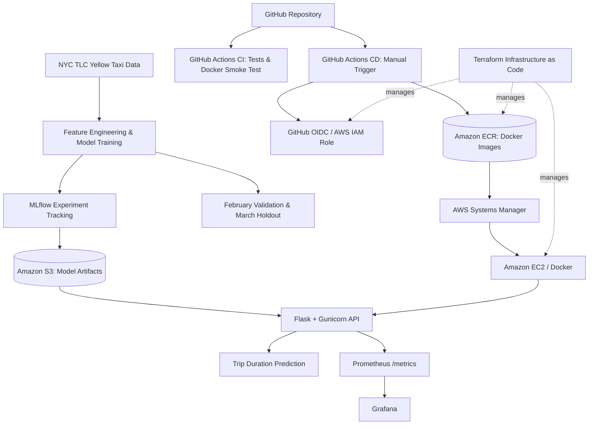

# 🚕 NYC Taxi Trip Duration Prediction — End-to-End MLOps

[](https://www.python.org/)
[](https://mlflow.org/)
[](https://www.docker.com/)
[](https://aws.amazon.com/)
[](https://www.terraform.io/)
[](https://github.com/features/actions)

An end-to-end machine learning engineering portfolio project that predicts New York City yellow taxi trip duration. It covers the six **MLOps Zoomcamp** areas: modeling, experiment tracking, orchestration, deployment, monitoring, and engineering best practices, with a working AWS CI/CD pipeline.

> **Deployment status:** The trained model was successfully served from an ECR-built Docker container on EC2, loaded through MLflow from S3, and tested through the Flask API. **GitHub Actions CD run #8** successfully deployed through AWS Systems Manager. The EC2 instance is intentionally stopped between tests to limit costs; there is no public live demo.

## Highlights

- Train and compare **Ridge**, **Random Forest**, and **HistGradientBoosting** models on NYC TLC yellow taxi data.
- Track experiments and store model artifacts with **MLflow**.
- Orchestrate training tasks with **Prefect**.
- Serve predictions with **Flask + Gunicorn**, packaged in **Docker**.
- Manage AWS resources and IAM policies with **Terraform**.
- Use **GitHub Actions** for CI, immutable image publishing to **Amazon ECR**, and manually triggered deployment to **Amazon EC2** via **AWS Systems Manager (SSM)**.
- Use **GitHub OIDC** for temporary AWS credentials, without long-lived AWS keys in GitHub.
- Expose **Prometheus** metrics, visualize with **Grafana**, and generate historical feature-drift reports.

## Architecture



### Technology stack

| Area | Tools |
|---|---|
| Data science | Python, Pandas, NumPy, scikit-learn |
| Experiment tracking / model artifacts | MLflow, Amazon S3, skops |
| Orchestration | Prefect |
| API | Flask, Gunicorn |
| Containers | Docker, Docker Compose, Amazon ECR |
| Cloud and infrastructure | Amazon EC2, SSM, IAM, Terraform |
| Automation | GitHub Actions, OIDC |
| Monitoring | Prometheus, Grafana, historical feature drift |
| Testing | pytest, API smoke tests |

## Data and modeling

Source: [NYC Taxi & Limousine Commission Trip Record Data](https://www.nyc.gov/site/tlc/about/tlc-trip-record-data.page).

| Split | Data | Purpose |
|---|---|---|
| Train | January 2023 | Fit models |
| Validation | February 2023 | Compare and select models |
| Holdout | March 2023 | Independent evaluation |

The model predicts **trip duration in minutes** from four features available at prediction time:

| Feature | Meaning |
|---|---|
| `PULocationID` | Pickup taxi zone ID |
| `DOLocationID` | Drop-off taxi zone ID |
| `pickup_hour` | Hour of pickup |
| `day_of_week` | Day of week |

Training uses bounded samples by default to keep experiments practical on a laptop. The March holdout is not used for model selection or hyperparameter tuning.

### Measured results

| Evaluation | Mean Absolute Error (MAE) |
|---|---:|
| February validation | **3.858 minutes** |
| March holdout | **4.084 minutes** |

These are historical evaluation results, not claims of live production accuracy.

## Repository workflows

### 1. Local setup

**Prerequisites:** Linux or WSL2, Python 3.11 for the documented local workflow, Git, and enough RAM for training. Docker and Docker Compose are needed for container workflows. AWS is optional for local experimentation.

```bash
 git clone https://github.com/nabilajalil/nyc-taxi-mlops.git
 cd nyc-taxi-mlops
 python3.11 -m venv .venv
 source .venv/bin/activate
 python -m pip install --upgrade pip
 pip install -r requirements.txt
```

### 2. Download data, train, and track experiments

```bash
bash scripts/download_data.sh
python -m src.train_compare
bash scripts/run_mlflow.sh
```

MLflow UI: <http://127.0.0.1:5000>.

### 3. Evaluate on the untouched holdout

```bash
bash scripts/download_test_data.sh
python scripts/evaluate_test.py
```

### 4. Run the Prefect training flow

```bash
python -m pipelines.training_flow
```

The flow demonstrates local task orchestration, retries, and observable runs. Unattended scheduled retraining is **not** enabled.

### 5. Serve and test locally

```bash
bash scripts/run_local.sh
bash scripts/test_api.sh
```

The API provides a prediction form at <http://127.0.0.1:8000/> and these endpoints:

| Method | Endpoint | Description |
|---|---|---|
| GET | `/` | Prediction form |
| GET | `/health` | Verify model availability |
| POST | `/predict` | JSON prediction |
| POST | `/predict-form` | HTML form prediction |
| GET | `/metrics` | Prometheus metrics |

**Example request:**

```bash
curl -sS -X POST http://127.0.0.1:8000/predict \
  -H 'Content-Type: application/json' \
  -d '{"PULocationID":161,"DOLocationID":236,"pickup_hour":14,"day_of_week":2}'
```

**Verified AWS test response:**

```json
{"predicted_duration_minutes":14.54}
```

The deployed ECR container returned **HTTP 200** for both `/health` and `/predict` during testing.

### 6. Docker and monitoring

Build the image:

```bash
docker build -t nyc-taxi-mlops .
```

The application can load a trusted local model via `MODEL_PATH` or a remote MLflow model via `MLFLOW_MODEL_URI`. **The production model is not bundled in the image.** Starting a container requires a reachable configured model artifact and appropriate credentials.

Start the provided local Compose stack (requires AWS model access with the current S3-backed configuration):

```bash
docker compose up --build
```

| Service | Local URL |
|---|---|
| API | <http://127.0.0.1:8000> |
| Prometheus | <http://127.0.0.1:9090> |
| Grafana | <http://127.0.0.1:3000> |

Configure Grafana's Prometheus data source as `http://prometheus:9090`. Change default Grafana credentials before any wider access. The monitoring services are intended for private/local use.

Generate a historical feature drift report:

```bash
python -m monitoring.drift_report
```

Output: `reports/drift.html`. Feature drift is **not** the same as model accuracy; labeled production performance monitoring is not implemented.

### 7. Tests

```bash
pytest -q
python -m compileall -q src app pipelines monitoring
```

GitHub Actions CI also builds the Docker image and runs an API smoke test with a test model, avoiding production AWS dependencies in CI.

## AWS deployment and CI/CD

The deployed architecture uses:

- **Amazon S3** for private MLflow model artifacts (`skops` serialization).
- **Amazon ECR** for Docker images tagged by Git commit SHA, with immutable tags.
- **Amazon EC2** running Docker and Gunicorn.
- **AWS Systems Manager** to run deployment commands remotely without opening public API ports.
- **IAM instance roles** for S3 model access and ECR image pulls.
- **GitHub OIDC** to assume a scoped AWS deployment role without static keys.

### CI — `.github/workflows/ci.yml`

Runs configured automated checks including Python tests, compilation, Docker build, and a container smoke test.

### CD — `.github/workflows/cd.yml`

Manually run from **GitHub → Actions → NYC Taxi MLOps CD → Run workflow**:

1. Authenticate to AWS with OIDC.
2. Check whether the commit-tagged image already exists in ECR; reuse it if present.
3. Otherwise build and push the image to ECR.
4. Check whether the existing EC2 instance is **running**.
5. If running, deploy via SSM, pull the image, and start the API container.
6. Call `/health` to verify model availability; fail the deployment job if the SSM command fails.

The deployment container binds to **`127.0.0.1:8001`** on EC2, alongside the pre-existing Docker Compose API on port `8000`. The workflow does **not** automatically start a stopped instance, and a successful workflow with a skipped deployment step should not be interpreted as a live deployment.

**Verified milestone:** GitHub Actions **CD run #8** succeeded with both the ECR publishing and SSM deployment jobs. A separate manual inference test returned **14.54 minutes** with HTTP 200.

### Terraform

Terraform configuration lives in `infra/terraform/` and manages the existing EC2 configuration, security controls, ECR, GitHub OIDC integration, and IAM permissions.

```bash
cd infra/terraform
terraform init
terraform fmt -check
terraform validate
terraform plan
```

Supply valid AWS credentials and any required variables before planning. **Inspect the plan carefully; do not blindly apply or destroy infrastructure.** Terraform is responsible for infrastructure management, while GitHub Actions handles application deployment.

## Security and cost considerations

- No permanent AWS access keys are stored in GitHub; deployment uses temporary OIDC credentials.
- S3 and ECR are private, with scoped IAM access.
- API and monitoring ports are bound to localhost rather than exposed publicly.
- SSM is used for remote execution instead of requiring public SSH access.
- The EC2 instance is intentionally stopped between tests to reduce compute costs.
- Stopped EC2 instances may still incur **EBS storage** costs; ECR and other services may also incur charges. AWS credits are not a hard spending cap.
- This is a portfolio demonstration, **not** a publicly hosted production service.

## Limitations and future work

- Training uses bounded samples and historical 2023 data; results are not production guarantees.
- Model promotion and retraining are not fully automated.
- CD is **manually triggered** and requires EC2 to be running.
- Deployment currently uses a separate API port rather than replacing the original Compose service.
- There is no public HTTPS endpoint, autoscaling, high availability, or automated rollback.
- Monitoring includes service metrics and historical drift, but not live ground-truth model accuracy.

Potential improvements include automated quality gates and model promotion, scheduled Prefect retraining, production-grade rollback, delayed-label performance monitoring, centralized logging, and secure HTTPS access.

## References

- [NYC TLC Trip Record Data](https://www.nyc.gov/site/tlc/about/tlc-trip-record-data.page)
- [MLOps Zoomcamp](https://github.com/DataTalksClub/mlops-zoomcamp)
- [MLflow](https://mlflow.org/docs/latest/)
- [Prefect](https://docs.prefect.io/)
- [AWS](https://docs.aws.amazon.com/)
- [Terraform](https://developer.hashicorp.com/terraform/docs)
- [GitHub Actions](https://docs.github.com/en/actions)

## Author

**Nabila Jalil** · [GitHub @nabilajalil](https://github.com/nabilajalil)

*Educational MLOps portfolio project demonstrating the machine learning lifecycle from experiment tracking to cloud deployment.*
